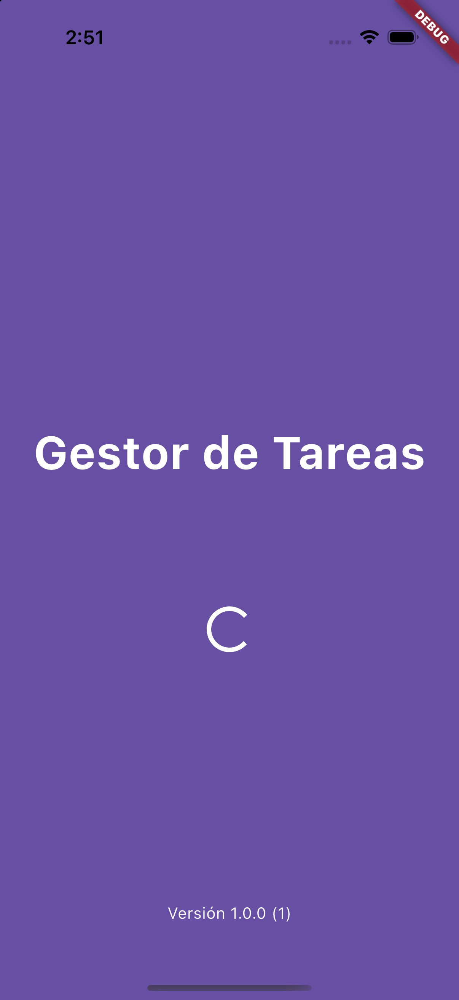
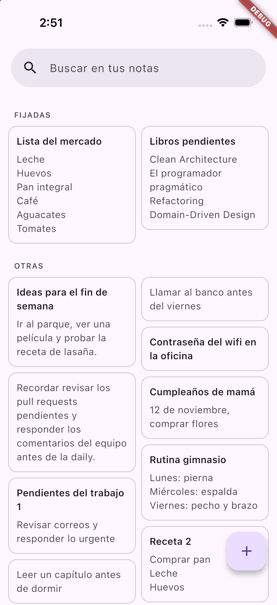
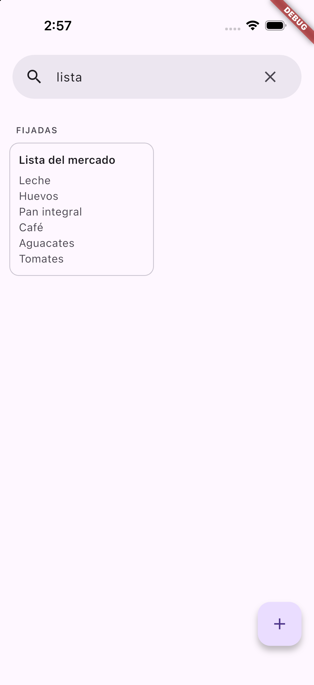
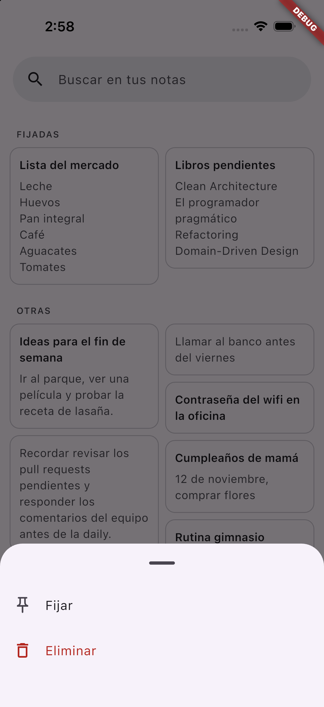
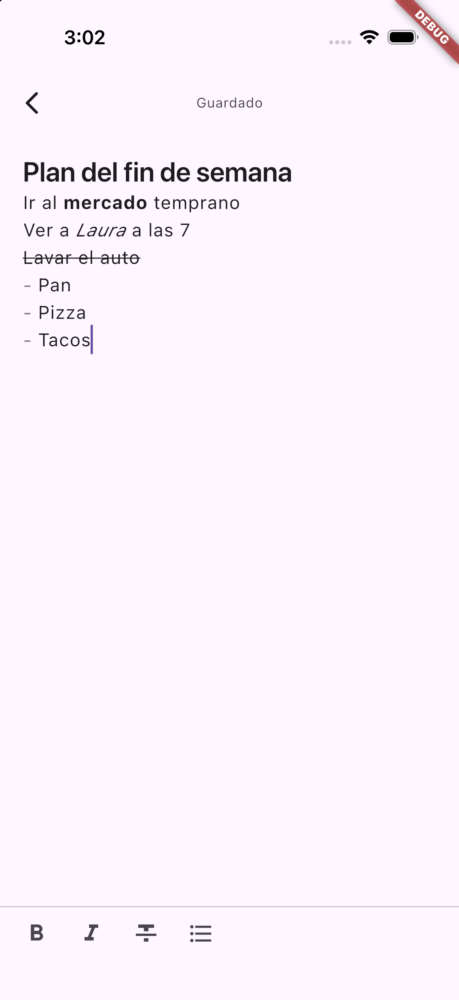
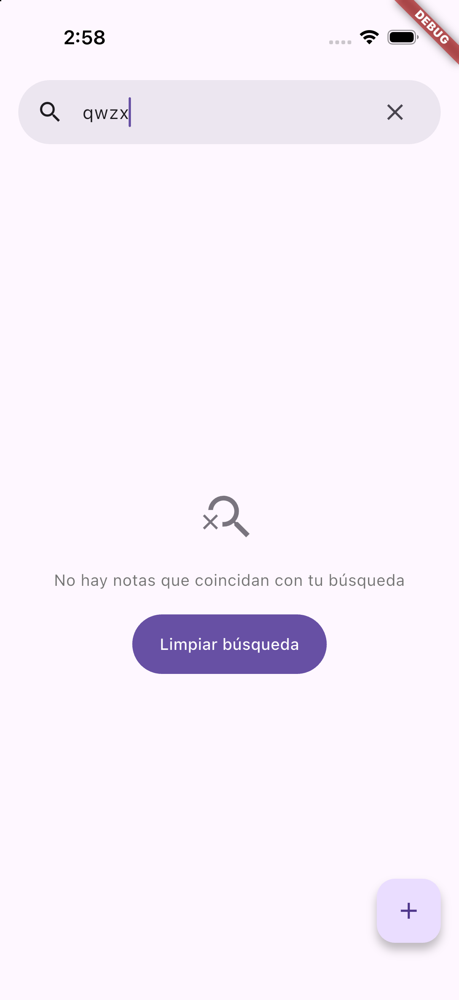
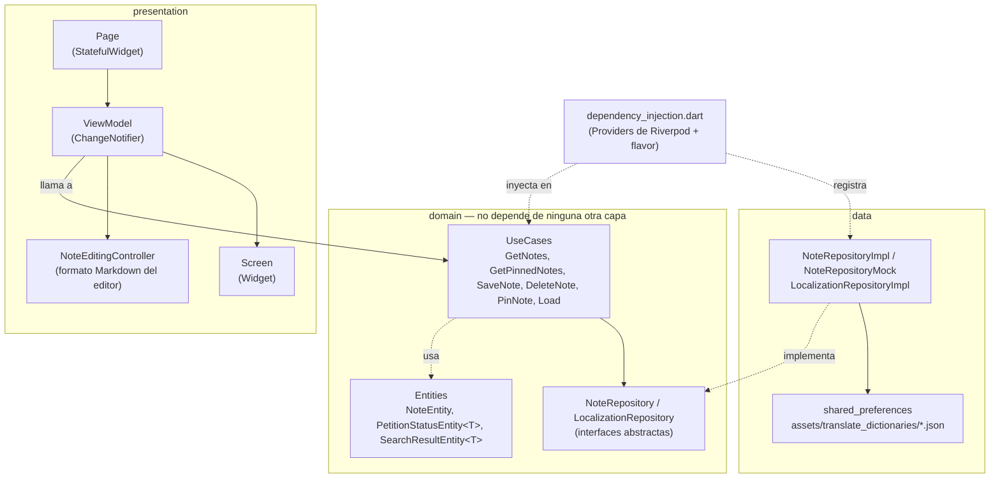

# Gestor de Tareas

App Flutter de **notas personales al estilo Google Keep**: buscas, fijas y eliminas notas desde una lista, y las creas o editas en un editor que guarda solo mientras escribes y acepta formato (negrita, cursiva, tachado y listas).

## ¿Qué hace?

- **Lista de notas** en dos columnas de alto libre, con una barra de búsqueda arriba. Las notas fijadas salen primero, en la sección "FIJADAS", y el resto en "OTRAS".
- **Búsqueda** por título o contenido mientras escribes.
- **Mantener presionada una nota** abre un menú para **fijarla** (máximo 5) o **eliminarla**.
- **Editor**: el primer renglón es el título, más grande, y el resto es el contenido. Una nota puede tener solo título o solo contenido, pero no puede quedar vacía.
- **Guardado automático**: la nota se guarda sola 800 ms después de que dejas de escribir, y también al salir.
- **Formato** con una barra de botones: negrita, cursiva, tachado y listas. Las marcas de formato no se ven, igual que en Keep.
- **Scroll infinito**: las notas no fijadas se cargan por páginas a medida que bajas.

Proyecto construido con **Clean Architecture** (domain / data / presentation), MVVM en la capa de presentación, **Riverpod** para estado global e inyección de dependencias, **go_router** para la navegación y **flavors** (`mock`, `dev` y `prod`).

## Capturas

| Splash | Lista de notas | Búsqueda |
|:---:|:---:|:---:|
|  |  |  |

| Opciones al mantener presionado | Editor con formato | Búsqueda sin resultados |
|:---:|:---:|:---:|
|  |  |  |

## Requisitos previos

| Herramienta | Versión |
|---|---|
| Flutter | `3.47.x` (canal stable; desarrollado con `3.47.5`) |
| Dart SDK | `^3.13.4` (definido en `pubspec.yaml`) |
| Xcode + CocoaPods | Solo para correr en iOS |
| Android Studio / Android SDK | Solo para correr en Android |

Verificar el entorno con:

```bash
flutter doctor
```

No se necesita ningún API key ni archivo `.env`: las notas se guardan en el dispositivo con `shared_preferences`.

## Cómo ejecutarlo

1. Clonar el repositorio:

   ```bash
   git clone https://github.com/marlonc98/pragma_road_1.git
   cd pragma_road_1
   ```

2. Instalar dependencias (como `pubspec.lock` no se versiona, este paso resuelve las versiones según los rangos de `pubspec.yaml`):

   ```bash
   flutter pub get
   ```

3. Correr la app con un flavor:

   ```bash
   flutter run --flavor mock
   ```

   En VS Code también se puede elegir el flavor desde **Run and Debug**: [.vscode/launch.json](.vscode/launch.json) tiene una configuración por flavor.

### Flavors

| Flavor | Nombre de la app | Notas |
|---|---|---|
| `mock` | [MOCK] Gestor de Tareas | En memoria, con 68 notas de ejemplo para probar la lista y el scroll infinito. Se pierden al cerrar la app. |
| `dev` | [DEV] Gestor de Tareas | Guardadas en el dispositivo con `shared_preferences`. |
| `prod` | Gestor de Tareas | Guardadas en el dispositivo con `shared_preferences`. |

Cada flavor tiene su propio `applicationId` / `bundleId` (`.mock`, `.dev`), así que los tres se pueden instalar a la vez. Si se corre sin `--flavor`, la app usa `prod`. El repositorio de cada flavor se elige en [dependency_injection.dart](lib/dependency_injection.dart).

## Cómo contribuir

Los commits siguen [Conventional Commits](https://www.conventionalcommits.org/) en inglés (`feat(notes): ...`, `fix(note-editor): ...`). Antes de abrir un PR:

```bash
dart format lib test
flutter analyze
flutter test
```

## Estructura de carpetas y arquitectura

El código en `lib/` está organizado en tres capas, siguiendo la regla de dependencia de Clean Architecture: `domain` no conoce a `data` ni a `presentation`; las otras dos capas dependen de `domain`, nunca al revés.



```
lib/
├── domain/              # Reglas de negocio puras, sin Flutter ni detalles de almacenamiento
│   ├── entities/         # NoteEntity, PetitionStatusEntity<T>, SearchResultEntity<T>
│   ├── repositories/     # Contratos abstractos (NoteRepository, LocalizationRepository)
│   ├── use_cases/        # Una operación de negocio por clase (note/, load_use_case.dart)
│   ├── states/           # Contrato de estado global (LocalizationState)
│   └── constants/        # Claves de error compartidas (ErrorsConstants)
│
├── data/                # Implementaciones concretas de los contratos de domain
│   └── repositories/
│       ├── note/          # NoteRepositoryImpl (shared_preferences) + api/, y NoteRepositoryMock
│       └── localization/  # LocalizationRepositoryImpl + api/
│
├── presentation/        # UI + estado de UI
│   ├── pages/            # Cada pantalla: Page + Screen + ViewModel (+ widgets/ propios)
│   │   ├── splash/        # Carga traducciones y versión, luego va a la lista
│   │   ├── notes/         # Lista con búsqueda, fijadas, opciones y scroll infinito
│   │   └── note_editor/   # Editor con guardado automático y barra de formato
│   ├── widgets/          # Reutilizables: buttons/ y loaders_status/ (carga, error, sin resultados)
│   ├── states/           # Implementación Riverpod de LocalizationState
│   ├── utils/            # ViewModel base + StfViewModelAdapter
│   ├── constants/        # TextConstants (claves de traducción) y MarkdownConstants
│   ├── router.dart       # Rutas con go_router
│   └── app.dart          # MaterialApp.router
│
├── flavors/flavors.dart       # Flavor actual y nombre de la app por flavor
├── dependency_injection.dart  # Todos los Providers (repositorios, estados y casos de uso)
└── main.dart                  # Punto de entrada: lee el flavor y envuelve la app en ProviderScope

assets/translate_dictionaries/  # Traducciones (es.json)
test/                           # Tests del repositorio, casos de uso y controller del editor
```

### Capas

- **domain**: define *qué* hace la app. Por ejemplo, `PinNoteUseCase` revisa que no haya más de 5 notas fijadas antes de fijar otra, sin saber que por debajo hay `shared_preferences`.
- **data**: define *cómo* se guardan los datos. Cambiar `shared_preferences` por un backend solo requiere otra implementación de `NoteRepository` y cambiar su Provider.
- **presentation**: dibuja la UI y reacciona a los cambios. Los `ViewModel` llaman casos de uso a través de los Providers, nunca a los repositorios directamente.

### Inyección de dependencias con Riverpod

[dependency_injection.dart](lib/dependency_injection.dart) declara todos los `Provider`/`NotifierProvider`, agrupados en repositorios, estados y casos de uso. `noteRepositoryProvider` elige la implementación según el flavor: `NoteRepositoryMock` en `mock` y `NoteRepositoryImpl` en `dev` y `prod`.

### Patrón de cada pantalla (Page / Screen / ViewModel)

- **`*_page.dart`**: `StatefulWidget` con su `route` estática; solo crea el `ViewModel` vía `StfViewModelAdapter`.
- **`*_page_view_model.dart`**: extiende `ViewModel<T>` (un `ChangeNotifier` con acceso a `context` y `WidgetRef`), llama a los casos de uso y expone el estado a la UI.
- **`*_page_screen.dart`**: widget que recibe el `ViewModel` y solo dibuja UI.

### Manejo de resultados asíncronos: `PetitionStatusEntity<T>`

Los repositorios devuelven [PetitionStatusEntity<T>](lib/domain/entities/petition_status_entity.dart): un wrapper con `status` (`notStarted` / `loading` / `complete` / `failed`), `data` y `error`. Los errores se muestran traducidos a partir de las claves de [ErrorsConstants](lib/domain/constants/errors_constants.dart).

### Cómo se guardan las notas

[NoteRepositoryImpl](lib/data/repositories/note/note_repository_impl.dart) usa `shared_preferences`, con una función por operación en `data/repositories/note/api/`:

- **Una clave por nota**: cada nota se guarda como JSON en `sp_note_{id}`, así se accede directo a una nota por su id.
- **Fijadas**: solo se guarda la lista de ids en `sp_pinned_notes`. Al cargar, la API marca qué notas están fijadas.
- **Lista**: las fijadas se cargan con `GetPinnedNotesUseCase` y las demás con `GetNotesUseCase`, por páginas. El contenido se recorta a 10 renglones con `...`, y el editor carga la nota completa por id antes de editarla.

### Editor

- **Guardado automático con debounce**: cada tecla reinicia un temporizador de 800 ms y solo se guarda cuando dejas de escribir. Los guardados se encadenan para que una actualización nunca se adelante a la creación.
- **Formato Markdown**: la barra inserta `**negrita**`, `_cursiva_`, `~~tachado~~` y `- ` para listas. Cada formato usa un carácter distinto para que sus marcas nunca se confundan aunque queden pegadas.
- [NoteEditingController](lib/presentation/pages/note_editor/controllers/note_editing_controller.dart) hace que el editor se comporte como Keep:
  - Interpreta las marcas con un parser de pila y las dibuja invisibles y sin ancho.
  - El cursor y el borrado se saltan las marcas.
  - Al dar Enter dentro de un formato, lo cierra y lo reabre en el renglón siguiente.
  - Continúa las listas con Enter, y un segundo Enter sobre la viñeta vacía la termina.
  - Respeta el autocompletado del teclado.

### Internacionalización

> **Hoy la app está solo en español (`es`).**

Los textos visibles usan claves de [TextConstants](lib/presentation/constants/text_constants.dart), y las traducciones viven en `assets/translate_dictionaries/<locale>.json`. Al agregar un texto nuevo, la clave debe ir en `TextConstants` y en **cada** JSON de idioma.

## Paquetes principales

| Paquete | Para qué se usa | Por qué está |
|---|---|---|
| `flutter_riverpod` / `riverpod` | Estado global e inyección de dependencias | Es el mecanismo central de la arquitectura: repositorios, estados y casos de uso se declaran como Providers. |
| `go_router` | Navegación entre splash, lista y editor | Rutas declarativas (`context.go` / `context.push`). El editor recibe la nota con `extra` y la lista se recarga cuando `push` termina. |
| `shared_preferences` | Persistencia local de clave-valor | Guarda las notas (una clave por nota) y los ids de las fijadas en los flavors `dev` y `prod`. También lo usa la localización para el idioma guardado. |
| `infinite_scroll_pagination` | Scroll infinito de las notas no fijadas | Ver [Por qué `infinite_scroll_pagination`](#por-qué-infinite_scroll_pagination). |
| `package_info_plus` | Leer la versión y el número de build | Se muestran en el splash (`Versión {version} ({build})`). |
| `flutter_flavorizr` (dev) | Generar los flavors `mock`, `dev` y `prod` | Configura Android e iOS (ids, nombres, esquemas de Xcode) desde `pubspec.yaml`. Está configurado para no tocar `main.dart`, `app.dart` ni los íconos. |
| `flutter_test`, `flutter_lints` (dev) | Tests y reglas de análisis estático | |

### Por qué `infinite_scroll_pagination`

Las notas no fijadas pueden crecer sin límite, así que no se cargan todas de una vez: se piden por páginas de 20 a medida que el usuario baja. Cargarlas todas significaría leer, decodificar y dibujar cada nota aunque nunca se vea.

Paginar a mano es poco código, pero tiene detalles fáciles de olvidar, y el paquete ya los resuelve:

- **No pide la misma página dos veces** mientras una carga está en curso.
- **Descarta respuestas viejas**: si el usuario busca otra cosa mientras llegaba una página, esa página se ignora.
- **Estados por página**: carga inicial, error con reintentar, lista vacía, cargando más y fin de la lista, cada uno con su propio widget.
- **Grilla de alturas libres**: `PagedSliverMasonryGrid` mantiene las dos columnas estilo Keep dentro del mismo scroll que las fijadas.

Es el mismo paquete y el mismo patrón (`PagingController` + `PagingListener`) que se usa en pragma_test_2026, para mantener la misma forma de trabajar entre proyectos.

Si se quisiera quitar la dependencia, el repositorio y los casos de uso ya están paginados (`page`, `itemsPerPage`). Solo habría que reemplazar el `PagingController` del ViewModel por un control manual de página y un `NotificationListener` en la pantalla.

## Archivos que no se versionan

El [.gitignore](.gitignore) excluye todo lo que es local a la máquina o sensible:

- **Generados / locales**: `build/`, `.dart_tool/`, `.idea/`, `*.iml`, `.metadata`, `pubspec.lock`, `Podfile.lock`, `Pods/`, `xcuserdata/`, `local.properties`, `.vscode/settings.json`.
- **Credenciales**: `.env` / `.env.*` (se permite `.env.example`), `key.properties`, keystores (`*.jks`, `*.keystore`), certificados y perfiles de iOS (`*.p12`, `*.p8`, `*.mobileprovision`), `google-services.json` y `GoogleService-Info.plist`.

## Limitaciones conocidas / próximos pasos

- La app está solo en español (`es`).
- Las notas del flavor `mock` viven en memoria y se pierden al cerrar la app.
- El editor no se cierra con el gesto de deslizar hacia atrás de iOS, para poder guardar lo pendiente antes de salir; se sale con el botón de la barra superior.
- La vista previa de la lista muestra el texto con sus marcas de formato tal cual (`**texto**`).
- Las notas guardadas con la cursiva vieja (`*texto*`) ya no se ven en cursiva.
